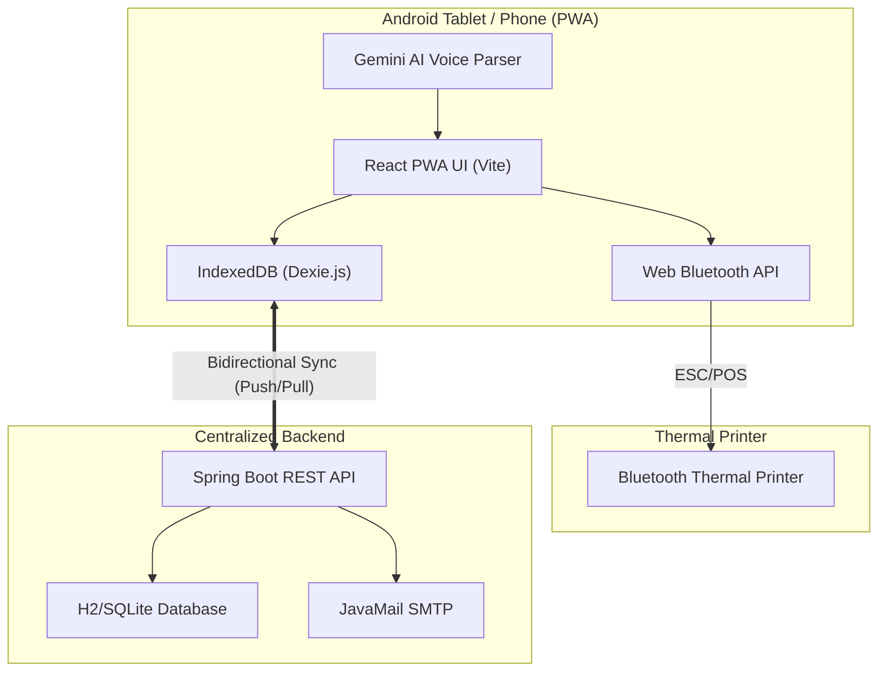
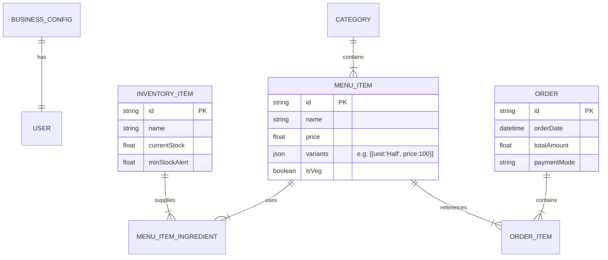

# POS Local - Master Implementation Plan & Architecture

A lightweight, offline-first POS application for small restaurant/cafe businesses, built with **React PWA** (frontend) and **Spring Boot** (backend), designed for Android tablets and phones.

---

## 1. System Architecture
The system follows a **Local-First** philosophy where all daily operations are handled by the browser's IndexedDB, with a Spring Boot backend acting as a centralized synchronization and reporting hub.

---

## 2. Key Database Schema (IndexedDB via Dexie.js)

---

## 3. Implemented Features (Update: May 2, 2026)

### A. Sales & Smart Ordering
- **AI Voice Ordering**: 
  - **Online**: Uses Google Gemini API for natural language parsing.
  - **Offline**: Automatic fallback to local fuzzy-matching regex parser.
- **Multi-Unit Pricing (Variants)**: Items can have multiple portions (e.g., Small/Large) with unique prices.
- **PIN Login Keyboard**: Integrated native keyboard support (hidden input) for faster staff login.

### B. Menu & Inventory Intelligence
- **Bulk Import**: CSV-based bulk upload for menu items with automatic category creation.
- **Recipe-Based Auto-Deduction**: Ingredients are automatically deducted from stock when an order is completed.
- **Low Stock Alerts**: Real-time visual monitoring based on configurable thresholds.

### C. Advanced Synchronization
- **Bidirectional Sync Loop**:
  - **Push**: Local orders, expenses, and business settings are backed up to the server.
  - **Pull (Master Data)**: Latest menu, recipes, and settings are retrieved from the server at every login.
- **Settings Sync**: Business info (Name, Address, GST) is centrally stored and shared across all devices.

### D. Analytics & Dashboard
- **Custom Date Range**: Dynamic filtering for all charts and stats (Today, Week, Month, or Custom).
- **Visual Trends**: Weekly sales line charts and payment mode pie charts using Recharts.

---

## 4. Infrastructure & DevOps
- **Reorganized Logging**: All logs stored in `./logs/` as human-readable plain text (ANSI stripped).
- **Unified Environment**: `run_all.cmd` launches both Frontend and Backend with automated log redirection.
- **PWA Excellence**: Optimized for standalone installation with mobile-responsive navigation.

---

## 5. Next Phase Roadmap
- [ ] **Bluetooth Thermal Printing**: Implementation of ESC/POS builder for KOT and Bills.
- [ ] **Kitchen Display System (KDS)**: Real-time order tracking for kitchen staff.
- [ ] **Multi-Role Permissions**: Separation of Admin and Waiter privileges.
- [ ] **Cloud Deployment**: Transition from localtunnel to a permanent HTTPS hosting environment.

---
*Last Updated: May 2, 2026*
